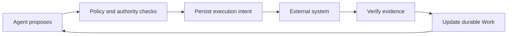

# Governed Work Runtime

**Let agents plan. Make every business action accountable.**

A small, durable runtime for work that must survive agent sessions and prove its results. Agents propose actions; policies gate execution; evidence establishes completion.

[中文](README.zh-CN.md) · [Website](docs/website.md) · [Architecture](docs/RFC-001-core-semantics.md) · [Protocol](docs/RFC-003-runtime-protocol.md) · [Verification](docs/verification.md) · [Contributing](CONTRIBUTING.md)

**Status: local reference prototype, pre-alpha.** Python 3.9+, Apache-2.0, zero runtime dependencies. The included expense and content-publication policies, and their OA/publisher adapters, are demonstrations. No hosted service, model API key or external account is needed.

## See it recover from a real crash

```bash
git clone https://github.com/WayJ/governed-agentic-work-runtime.git
cd governed-agentic-work-runtime
python3 -m work_runtime demo
```

The demo creates fresh temporary databases, starts a separate worker, and deliberately terminates it after the external service has committed. Restarting the runtime queries the original operation and recovers its receipt.

```text
1. Agent proposes submission → BLOCKED by E05 (approval missing)
2. Work waits durably; no model session needs to stay alive
3. Finance approves current content → submission intent accepted
4. OA accepts → worker exits before saving the response (real process crash)
5. Restart → query original operation → existing OA receipt recovered
6. Evidence-backed completion → SUCCEEDED; external applications created: 1
```

The final line is asserted against a separate persistent fake OA database. The demo prints an `inspect` command for the saved work and event history. Every run creates a new directory; it does not overwrite previous runs.

## Watch signed evidence gate a publication

```bash
python3 -m work_runtime publish-demo
```

A second business domain runs on the same Runtime class in its own database. Reviewer approval and author confirmation arrive as HMAC-signed envelopes: a tampered approval is rejected before any intake write, valid signatures still only create candidates until verification, and a publish call that times out after the external commit is recovered by querying the same operation — never resubmitted.

```text
1. Agent proposes publication → BLOCKED by C02 (reviewer approval missing)
2. Tampered reviewer approval → rejected EVIDENCE_AUTHENTICATION_FAILED before any intake write
3. Valid signed approval/confirmation stay candidates until verified → intent accepted
4. Publisher commits, response times out → outcome unknown, artifact exists
5. Restart → query the same operation → receipt recovered, nothing resent
6. Evidence-backed completion → SUCCEEDED; published artifacts: 1
```

The final line is asserted against the separate publisher database (`publications` table), and the printed command `inspect --policy content-publish` reads back the saved work and events. The signature proves source authenticity and content integrity only — not business truth; see [signed evidence](docs/signed-evidence.md).

## Watch interventions stop work without losing effects

```bash
python3 -m work_runtime intervention-demo
```

Three intervention scenarios run on the same Runtime class, each against its own fresh pair of databases: an ownership transfer that invalidates the prepared intent and denies the former owner (including replaying an already-accepted command), a cancellation that cannot complete while an external effect is uncertain — reconciling the original business key recovers exactly one effect, and closing requires acknowledging exactly that effect — and an explicit same-family policy migration that invalidates the old approval, strengthens the approval rule and re-admits the same operation once version-bound approval arrives.

```text
Scenario A — ownership transfer (own store: transfer/)
1. Agent proposes submission → intent prepared while agent owns the work
2. transfer_owner agent → delegate → prepared intent invalidated (OWNERSHIP_TRANSFERRED)
3. Former owner re-proposes → AUTHORITY_DENIED; replays the accepted command → fresh AUTHORITY_DENIED, stored receipt untouched; dispatch stays cancelled (0 external calls)
4. New owner re-proposes → SAME operation id (business key stable) → intent readmitted
5. Dispatch → confirmed_succeeded; accepted applications in this store: 1

Scenario B — cancellation with an uncertain external effect (own store: cancel/)
1. Agent proposes submission → intent prepared
2. Dispatch → OA accepted, response lost after commit → outcome unknown (the effect exists)
3. request_cancel → intent stored; finalize now → OUTCOME_UNRESOLVED while the effect is unknown
4. Reconcile the ORIGINAL business key → confirmed_succeeded, external id recovered, nothing resent
5. finalize [] → CANCEL_ACKNOWLEDGEMENT_MISMATCH; exact acknowledgement [op] → CLOSED cancelled
6. Acknowledgement records the effect (no reversal); accepted applications in this store: 1

Scenario C — explicit policy migration demo-1 → demo-2 (own store: migrate/)
1. Under-limit expense bound to demo-1 → E05 not applicable; a demo-1-shaped approval exists
2. work.intervene admin migrates to demo-2 → revision 2; old approval INVALID; E05 applicable + pending; prepared intent invalidated (POLICY_MIGRATED)
3. Re-propose → REQUIREMENT_UNSATISFIED; stale contract revision → CONTRACT_REVISION_MISMATCH
4. Finance approves under demo-2 ({digest, policy_version}) → E05 satisfied → SAME operation readmitted
5. Restart without the registry → fails closed; restart with the registry → pinned demo-2 usable
   (restart without the registry: Load the policy version bound to this Work; migration is not implicit)
6. Dispatch → confirmed_succeeded; accepted applications in this store: 1

3 scenarios; accepted applications: 3 (one per store); effects reversed: 0
```

Every count is asserted against the scenario's own external database: zero external calls while the intent is merely prepared or cancelled, exactly one accepted application after each external acceptance. Closing a cancelled work records the acknowledged effect with its external id — acknowledgement is durable bookkeeping, not compensation; nothing is reversed. The owners, delegates and administrators in the grants map are trusted local principals, not authenticated identities. A work pinned to `demo-2` is readable only with its version registry loaded — the printed `inspect --policy-versions demo-1,demo-2` command does exactly that; without the flag, inspection fails closed.

## Adopt it: lint a rule card, publish a real file

```bash
python3 -m work_runtime adoption-demo
python3 -m work_runtime lint-sop work_runtime/data/sop/publishing.json
```

The fourth demonstration is the adoption path a new contributor takes. The static prologue lints SOP rule cards — an invalid card yields bounded diagnostics, the two packaged cards lint clean with their exact SHA-256 content digests — and states plainly that linted JSON is never executed. The live part then runs the unchanged Runtime and publication policy with HMAC-signed reviewer/author evidence and the third adapter, `FilePublisher`: after approval and verification, a real hash-named JSON artifact is committed to a fresh directory, the response is then lost (a composition wrapper raises after the real commit), and a restarted Runtime recovers by querying the original business key — never resubmitting.

```text
1. Invalid demo card -> 3 diagnostics, first EMPTY_VALUE at /policy/goal (lint-sop exit 1)
2. Packaged cards lint-clean with exact content digests (lint-sop exit 0)
3. Agent proposes publication -> BLOCKED by C02 (reviewer approval missing)
4. Tampered reviewer approval -> rejected EVIDENCE_AUTHENTICATION_FAILED before any intake write
5. Valid signed approval/confirmation stay candidates until verified -> intent accepted
6. FilePublisher commits a real hash-named artifact; response lost AFTER the commit -> outcome unknown
7. Restart -> reconcile the ORIGINAL business key -> confirmed_succeeded, nothing resent
8. Evidence-backed completion -> SUCCEEDED; committed file artifacts: 1
```

The final count is asserted against the actual publisher directory (exactly one `[0-9a-f]{64}.json` file), and the printed `inspect` command and artifact path work verbatim. `lint-sop` exits 0 clean / 1 diagnostics / 2 file errors (duplicate object keys, non-finite literals, invalid UTF-8, malformed JSON, unreadable or >1 MiB files are all exit 2 and never echo file contents); `--json` prints the exact static-only result envelope. Linting is structural review only — no textual predicate is executed and no publication authority is conferred. To extend the runtime yourself — a third-party-style adapter through the public conformance tests, or a reviewed rule card — see the [contributor guide](docs/contributor-guide.md).

## Revoke evidence without erasing history

```bash
python3 -m work_runtime revocation-demo
```

The fifth demonstration exercises evidence revocation on the same Runtime in both policy families, each scenario against its own fresh stores. A verified approval is revoked through the version-bound `revoke_evidence` command with payload exactly `{source, event_id, reason}`; the prepared intent is then held at dispatch with zero external calls, and a replacement approval under a new event id re-admits the same operation on the same business key. A second scenario revolves proofs around an uncertain external effect: the already-committed application is retained exactly once — recovered by reconciling the original business key, never resent, never re-executed after confirmation, and completion stays blocked while the proofs are revoked. The third closes a publication and then revokes its acceptance: the historical completion stays byte-identical, the current requirement turns pending again, and the `EvidenceRevoked` event records `work_was_closed` and `completion_cites_evidence`.

```text
Scenario A — revoked approval holds dispatch; replacement readmits (own store: hold/)
1. Verified finance approval → agent proposes submission → intent prepared
2. Finance (current approval source, evidence.revoke) revokes {source, event_id, reason} → accepted, evidence_status "revoked", prior verified; E05 pending
3. Re-propose → rejected REQUIREMENT_UNSATISFIED (E05: a revoked proof no longer authorizes admission)
4. Dispatch the prepared intent → held REQUIREMENT_UNSATISFIED, zero attempts, zero external calls
5. Replay the same revoke command → stored receipt verbatim; still exactly one EvidenceRevoked event
6. Resend the SAME source event under a NEW command → same evidence id, evidence_status "revoked" — no new row, no revival
7. REPLACEMENT approval (new event id) → E05 satisfied → SAME operation id readmitted → dispatch → confirmed_succeeded
   accepted applications in this store: 1; effects reversed: 0

Scenario B — revoked proofs around an uncertain external effect (own store: uncertain/)
1. Verified finance approval → agent proposes submission → intent prepared
2. Dispatch → OA accepted, response lost after commit → outcome_unknown (the effect exists)
3. Reconcile the ORIGINAL business key → confirmed_succeeded, external id recovered, nothing resent; the uncertain effect is retained exactly once
4. work.intervene administrator revokes the confirmed acceptance → E08 pending
5. Re-propose → SAME operation returned already confirmed_succeeded — a confirmed effect never re-executes to regenerate a revoked proof
6. Finance revokes the approval → E05 pending (current authority withdrawn after the fact)
7. request_completion → rejected REQUIREMENT_UNSATISFIED (E05 revoked approval, E08 revoked acceptance); accepted applications in this store: 1; effects reversed: 0

Scenario C — publishing: hold, readmission, closed-work correction (own store: publish/)
1. Verified reviewer approval and author confirmation → publication intent prepared
2. Reviewer (current approval source, evidence.revoke) revokes the approval → C02 pending
3. Dispatch → held REQUIREMENT_UNSATISFIED, zero attempts, zero published artifacts
4. REPLACEMENT approval (new event id) → C02 satisfied → SAME operation id readmitted → published artifacts: 1
5. Evidence-backed completion → SUCCEEDED; the completion cites the verified acceptance
6. Administrator revokes the acceptance on the CLOSED work → outcome and completion stay byte-identical; C04 pending; EvidenceRevoked records work_was_closed and completion_cites_evidence
7. Resend the revoked approval event under a NEW command → evidence_status "revoked", same evidence id; published artifacts in this store: 1; effects reversed: 0

3 scenarios; retained external effects: 2 accepted applications, 1 published artifact; effects reversed: 0
```

Every count is asserted against the scenario's own external database. Revocation withdraws current validity only: it never edits receipts, closure snapshots or external effects, and it is not compensation — `effects reversed: 0` is a counted fact, not a slogan. The revoking principals are the work's currently configured evidence source holding the `evidence.revoke` grant, or a `work.intervene` administrator — trusted local grants, not authentication; revocation does not fence an in-flight external call. See [evidence revocation](docs/evidence-revocation.md).

## Withdraw an accepted expense — compensation, not erasure

```bash
python3 -m work_runtime compensation-demo
```

The sixth demonstration exercises the bounded S10 compensation slice: an expense withdrawal that executes only inside an active cancellation. The forward expense is accepted with its receipt, invoices and proof; after `request_cancel` the owner proposes the linked withdrawal (`compensates` = the confirmed original operation id), and the runtime stores the immutable original snapshot under a separate stable business key. A grants-carrying worker subprocess dispatches it and really dies after the external withdrawal commits; a restarted runtime recovers by reconciling the original business key — one attempt, nothing resent. The withdrawal appends a distinct `withdrawn` proof; the forward acceptance, its receipt and the E08 fulfillment stay exactly as they were — history is appended, never deleted. Closing acknowledges exactly the two succeeded ids (original + withdrawal). The second scenario points the withdrawal at an external store that never saw the original: the adapter answers an authoritative stored `ORIGINAL_ABSENT` refusal, the runtime records `confirmed_failed` with the refusal reason in `adapter_result`, and the closure acknowledges only the retained original — a refusal is explicit, never a reversal and never an unknown; an unresolved compensation blocks closure rather than being abandoned.

```text
Scenario A — accepted expense withdrawn inside the cancellation window, across a real worker crash (own store: crash/)
1. Verified invoices, duplicate clear, requester confirmation and finance approval → submission → OA accepts (OA-…) → confirmed_succeeded; E08 satisfied by the accepted proof
2. Admin (work.intervene) requests cancellation — the window opens; nothing is reversed by that request alone
3. Owner proposes the linked withdrawal (five-key payload, compensates=<original id>) → prepared with the immutable original snapshot {operation_id, external_id, capability} and its own stable business key — separate from the forward key
4. A grants-carrying worker subprocess dispatches the withdrawal → the external withdrawal commits (WD-…) → the worker dies before recording the outcome (exit code 73). The shipped worker CLI cannot take this step: its demo grants hold no expense.withdraw, so it would hold the dispatch AUTHORITY_DENIED with zero attempts and zero effects
5. Restart → recover() reconciles the original business key → confirmed_succeeded in exactly one attempt (nothing resent)
6. Store truth, read back read-only: the forward accepted proof is still verified and still satisfies E08; the withdrawal appended a distinct withdrawn-kind proof and its own receipt — accepted applications 1, withdrawal effects 1; history appended, never deleted
7. Admin finalizes with the exact two-id ack (original + succeeded withdrawal) → closed/cancelled; the closure disposition carries compensates + the stored adapter result
   accepted applications: 1; withdrawal effects: 1 (asserted against this scenario's own SQLite stores)

Scenario B — withdrawal pointed at an external store that never saw the original: authoritative refusal, not reversal (own store: refusal/)
1. Fresh expense accepted and confirmed in its own external store (OA-…)
2. Cancellation requested → linked withdrawal prepared with the same immutable snapshot shape and its own stable key
3. Dispatch is caller-trusted: pointing the withdrawal at a second external store (absent.sqlite) that holds no forward receipt for the original yields an authoritative stored rejection ORIGINAL_ABSENT — a queryable receipt with zero withdrawal effects, a bounded refusal that is neither an unknown nor a fabricated withdrawal
4. The failure is explicit: the runtime records confirmed_failed with the refusal reason stored in adapter_result, and finalize acknowledges ONLY the retained forward effect (ack = exactly one id); the closure disposition keeps the refusal — refusal is not reversal, the original effect remains
   accepted applications: 1; withdrawal effects: 0; refused receipts: 1

2 scenarios; retained forward effects: 2 accepted applications; withdrawal effects: 1; refused withdrawals: 1; refusal is not reversal
```

Every count is asserted against the scenario's own external database: the crash store ends with exactly one accepted application and one withdrawal effect, the refusal store with one accepted application, zero withdrawal effects and one queryable rejection. The dispatching worker is a scoped grants-carrying child — the shipped `worker` CLI hardwires the demo grants, which hold no `expense.withdraw`, so routing a withdrawal through it holds `AUTHORITY_DENIED` with zero attempts and zero effects (a pinned test says exactly that). This is expense-family, active-cancellation-window compensation only: publishing compensation, post-closure compensation, chains and a public abandon command stay unimplemented; a refused or unknown withdrawal never rewrites the original effect, the withdrawn proof can never be imported and is revocable only by an administrator, and the principals are trusted local grants, not authenticated identities. See [interventions](docs/interventions.md).

## Rotate a source signing key without rewriting history

```bash
python3 -m work_runtime rotation-demo
```

The seventh demonstration exercises configured source signing-key rotation (S11). A source holds a keyring — named keys, an explicit `current` entry and inclusive validity windows — and envelopes may cite their key through a `key_id` that is part of the signed content. The demo runs deterministically on an injected clock with ephemeral in-memory keys (only key ids are ever printed — never the secrets): both keys authenticate during the dual-key window; rotation flips the current key and keeps the old one inside a grace window, where replaying the original envelope still returns its cached receipt at the exact boundary; one second past grace the same envelope is refused `EVIDENCE_KEY_RETIRED` — authentication runs ahead of the command cache, so the stored receipt is unreachable and nothing is written; re-signing the same command id under the new key returns the original cached receipt byte-verbatim with no new row; a new command id for the same event reports the current status with exactly one new command row; and a six-table history digest proves the rotation acts wrote nothing.

```text
Scenario — rotate a source signing key without rewriting history (own store: rotate/)
ephemeral in-memory keys finance-2026-08 (current) and finance-2026-10; secrets are never printed, only key ids
1. Dual-key window: approvals signed by both keys authenticate under one keyring → accepted (pending_verification)
2. verify_pending → both approvals verified (the last legitimate writes before rotation)
   six-table digest before rotation: <16-hex digest>
3. Rotate: finance-2026-10 becomes current, finance-2026-08 retained with not_after = T+300 (grace == max_age); clock AT the boundary → replay the ORIGINAL old-key envelope → the ORIGINAL cached receipt returned verbatim, zero writes
4. Clock one second past grace: the SAME original envelope → rejected EVIDENCE_KEY_RETIRED (window precedes freshness; the cached receipt is unreachable behind authentication), zero writes
5. Re-sign under the new key, SAME command id and business payload (fresh timestamp) → the ORIGINAL cached receipt byte-verbatim; no new command row, zero writes
6. NEW command id, same source event → accepted; evidence_status "verified" (the CURRENT status); exactly one new command row, no new evidence row
7. six-table digest after all steps: <16-hex digest> — all six tables stayed byte-identical to before rotation through the boundary replay, the retired refusal and the re-sign; the new command appended exactly one commands row (five tables still byte-identical)
1 scenario; dual-key accepts: 2; retired refusals: 1 (zero writes); cached receipts verbatim: 2; new commands: 1; history rewritten: 0
```

Every claim is asserted against the demo's own SQLite store — the digests, statuses, fingerprints and command-row counts are recomputed by the tests and the installed verifier, never parsed from the narration. Rotation is configuration-only trust: the keyring configuration is the only place key identity lives — which key admitted a proof is never recorded, there is no persisted revocation memory or rotation audit, and redeploying a pre-rotation configuration revives the old key (rollback and retired key-id reuse are operator discipline). A compromised current key stays forgeable until rotation lands and the grace window expires; wall-clock trust is the operator's. None of this is tenant authentication, TLS, an external KMS, distributed revocation or any security certification. See [signed evidence](docs/signed-evidence.md).

## Browse it: a local read-only GUI

```bash
python3 -m work_runtime ui-demo                                   # seed a five-work sample, then serve it
python3 -m work_runtime ui --db <existing-runtime.sqlite>         # serve an existing store
```

The command prints the actual loopback URL and serves until `Ctrl-C`. The page is an offline, dependency-free bilingual (English/Chinese) viewer over what the store actually recorded: metric tiles with definitions, a searchable/filterable work list, and per-work detail covering current requirements, evidence, operations with attempts, persisted command decisions, the keyset-paginated event timeline and the exact stored documents as text. Stored payloads are rendered as text only — never parsed, never executed — and string-encoded integers keep their exact digits. `ui-demo` seeds its five-work sample (waiting, needs-attention with a retained external effect, transferred, succeeded, cancelled-with-acknowledged-effect) through real commands and the real FakeOA; see the [GUI guide](docs/gui.md). The viewer opens stores read-only on loopback; that binding is convenience, not authentication. Serving needs the read-only backend module assembled in the install — without it the `ui` commands exit 2 with a bounded message and every other command keeps working.

## Why a Work Runtime?

A business task can outlive its conversation. Its plan can change, approval can arrive days later, and a timed-out API request may already have created a real application.

This project keeps the responsibility, constraints and evidence in a persistent **Work**. The agent can choose a strategy while the runtime enforces the accepted rules around its actions.



Three distinctions shape the implementation:

| Distinction | Practical result |
|---|---|
| Work vs. plan | Removing a step cannot remove the requirement for approval |
| Command vs. operation vs. attempt | Lost responses and retries retain the original business identity |
| Execution vs. proof | A completed tool call cannot establish a business result without matching evidence |

## What works today

- Persistent work state, version checks, immutable command receipts and append-only change events.
- Independent deduplication of command requests, source events and logical business operations.
- Version-bound approval and confirmation; unknown amounts and incomplete invoice sets block submission.
- Evidence intake followed by verification; adoption and requirement evaluation commit together.
- Durable waits, early event handling, explicit expiry and restart recovery.
- Dispatch-time authority checks, held or cancelled unstarted intents, and reconciliation of uncertain outcomes.
- A persistent fake OA that enforces invoice uniqueness across different works.
- HMAC-signed evidence ingress: strict envelopes, per-source keys or named keyrings with an optional signed `key_id` selector and inclusive validity windows (S11 rotation: dual-key windows, retirement refused `EVIDENCE_KEY_RETIRED` ahead of the cache, re-signed commands returning their original cached receipts verbatim — no history rewrite), freshness and tampering rejected before any write; the reserved `accepted` kind cannot be supplied through ingress.
- Declared adapter contracts with reusable conformance tests and dispatch-time capability checks.
- A second business domain (content publication) on the same Runtime: review gating, content-bound evidence and one published artifact per `(document id, content digest)`.
- Ownership transfer, cancellation and explicit same-family policy migration: prepared intents are invalidated with recorded reasons, uncertain effects must reconcile before cancellation completes, and closing requires acknowledging the exact set of succeeded effects with their external ids — recorded, never reversed.
- An explicit per-runtime policy registry: works stay pinned to their bound version, restarts fail closed until that version is loaded, and migration revalidates every piece of evidence under the target policy before binding changes.
- Static SOP rule-card linting with deterministic diagnostics and exact content digests (`lint-sop`, packaged example cards shipped inside the package) — structural review only, never executable authority.
- A third, real-filesystem adapter (`FilePublisher`): one immutable hash-named JSON artifact per idempotency key, committed atomically, queryable after restart — plus the no-credentials adoption harness above.
- Explicit evidence revocation: a version-bound `revoke_evidence` command (`{source, event_id, reason}`) permanently withdraws a proof's current validity — revoked proofs never verify, migrate or revive on restart, and resends report the current status — while receipts, closure snapshots and accepted external effects stay immutable: held intents make zero external calls, replacement proofs re-admit the same operation, and revoking a closed work's acceptance preserves the historical completion byte-for-byte.
- Bounded expense compensation (S10): inside an active cancellation the linked `expense.withdraw` executes as its own external operation with an immutable original snapshot and a separate stable key; accepted withdrawals append a `withdrawn` proof while the original history stays intact, a missing original is an authoritative stored `ORIGINAL_ABSENT` refusal, and closure acknowledges the exact succeeded ids — no general reversal, no abandon.
- An offline read-only operations GUI (`ui`/`ui-demo`): bilingual light interface over durable records — tiles, searchable list, requirements/evidence/operations/decisions/events/documents detail, exact stored JSON as text — with a real-command five-work sample seed and packaged assets.
- A replaceable `Policy` interface and an `Adapter` interface for execution and lookup.

The core API is a trusted, in-process library. Application code supplies source identities and grants; these names do **not** authenticate remote callers — owners and `work.intervene` administrators are trusted local principals, not authenticated identities. The signed ingress authenticates evidence sources within a configured shared-key boundary — it is not transport security, tenant authorization, or proof of business truth. One policy family owns each runtime database; works may pin different versions of that family through an explicitly loaded registry, and the two demo domains use separate databases on the same Runtime class. The coordinator is local, and the prototype does not implement distributed worker leases, policy publishing, general compensation (effect reversal), or multi-tenant authorization: cancelling a work or revoking evidence preserves its external effects. The bounded exception is S10 expense compensation: during an active cancellation the linked `expense.withdraw` executes as its own external operation and records a `withdrawn` proof while the original effect's history stays intact — publishing, post-closure and chained compensation remain unimplemented. Unsupported lifecycle commands are rejected explicitly. Full RFC coverage is tracked in [verification](docs/verification.md).

## Use the local API

This example uses helpers from the demonstration. `prerequisites` simulates trusted verification, user confirmation and finance approval; a real integration must obtain these from its authenticated sources.

```python
from work_runtime import ExpensePolicy, Runtime
from work_runtime.adapters import FakeOA
from work_runtime.demo import action, demo_grants, initialize, prerequisites, send

runtime = Runtime(".runtime/work.sqlite", ExpensePolicy(), demo_grants())
oa = FakeOA(".runtime/oa.sqlite")

initialize(runtime, work_id="expense-1")
prerequisites(runtime, work_id="expense-1")
receipt = action(runtime, work_id="expense-1")

assert receipt["decision"] == "accepted"  # Intent persisted; external execution is pending.
runtime.dispatch(receipt["operation_id"], oa)
completion = send(runtime, "expense-1", "request_completion")
assert completion["decision"] == "accepted"
```

`initialize` is for creating a new work once. After restarting, read the existing work and call `runtime.recover(oa)` to verify pending evidence and reconcile operations. Queries returning no authoritative external result cause intervention rather than blind resubmission.

Bounded compensation (S10) is the same protocol with two additions — the grants must carry the compensating capability for the owner (the shipped demo grants deliberately do not, so a withdrawal-dispatching worker needs its own grants; the compensation demo runs one as a child subprocess), and the proposal carries `compensates`:

```python
from work_runtime.compensation_demo import compensation_grants, withdrawal

runtime = Runtime(".runtime/compensation.sqlite", ExpensePolicy(), compensation_grants())
initialize(runtime, work_id="expense-2")
prerequisites(runtime, work_id="expense-2")
forward = action(runtime, work_id="expense-2", command_id="submit-once")
runtime.dispatch(forward["operation_id"], oa)
send(runtime, "expense-2", "request_cancel", {"reason": "duplicate found"}, actor="admin")
proposal = withdrawal(runtime, "expense-2", forward["operation_id"], command_id="withdraw-once")
assert proposal["decision"] == "accepted"  # immutable original snapshot, own stable key
resolved = runtime.dispatch(proposal["operation_id"], oa)  # requires expense.withdraw
assert resolved["status"] == "confirmed_succeeded" and resolved["external_id"].startswith("WD-")
```

## Verify a checkout

```bash
python3 -m unittest discover -s tests -v             # tests gate
python3 scripts/check_docs.py                        # contracts gate: local doc links resolve
python3 -m work_runtime demo                         # demo gate: real crash recovery
python3 -m work_runtime publish-demo                 # demo gate: signed-evidence publication
python3 -m work_runtime intervention-demo            # demo gate: transfer, cancel, migrate
python3 -m work_runtime adoption-demo                # demo gate: lint + file-adapter adoption
python3 -m work_runtime revocation-demo              # demo gate: evidence revocation, both families
python3 -m compileall -q work_runtime tests scripts  # syntax gate
python3 scripts/check_site.py                        # site gate: developer website structure
python3 scripts/verify_install.py                    # fresh venv, install, demos outside the checkout
```

The first nine commands are the repository's gates. The sixth demonstration, `python3 -m work_runtime compensation-demo` (see its section above), is explicit S10 validation — it is deliberately not one of the gates, and the gate list is unchanged. The seventh, `python3 -m work_runtime rotation-demo` (see its section above), is explicit S11 validation, likewise deliberately not one of the gates. The site gate structurally checks the bilingual developer website assembled under `website/` (preview, publishing and scope in [the website guide](docs/website.md)); it needs those pages assembled to pass and says nothing about browser behavior. `scripts/verify_install.py` goes further: it builds the package into a brand-new virtual environment, asserts the import comes from that venv rather than the checkout, checks that no third-party dependency was installed, and runs the demos with the working directory outside the repository — counting exactly one external application in the fake OA database, exactly one publication in the publisher database, exactly one accepted application per intervention store, and, for both the module and console entry points of `adoption-demo`, independently enumerating and parsing exactly one committed hash-named file artifact (digest, receipt, business key and work outcome re-verified with the standard library only) rather than trusting the printed output. For both entry points of `revocation-demo` it additionally re-verifies the three scenario stores directly: revoked/verified evidence statuses, preserved source-event fingerprints, the stable business key of the single readmitted operation, the closed work's completion still citing the revoked acceptance, and exactly one retained external effect per store. For both entry points of `compensation-demo` it also re-verifies the two scenario stores directly: business keys recomputed with the standard library, the immutable link and the stored adapter result bound to the original, tagged receipts with the recomputed link digest, exactly one withdrawal row, unchanged invoices, the withdrawn-kind proof (never a forward accepted proof) with the retained E08 truth, the exact two-id closure ack, and the refusal scenario's authoritative `ORIGINAL_ABSENT` rejection with a single-id ack and zero effects. For both entry points of `rotation-demo` it also re-verifies the rotation store directly: the six-table history digest recomputed locally and matched against the printed digest, verified evidence fingerprints, the original cached receipt for the re-signed command id, and exactly one command row per rotation command id. It also confirms the packaged SOP cards and GUI web assets ship inside the install and the installed `lint-sop` reproduces the pinned digest; when the read-only UI backend module is present in the install it additionally drives the installed `ui-demo`/`ui` entry points as real subprocesses over real HTTP (asset byte-equality, the five seeded works, store tables unchanged, clean interrupt) and otherwise prints an explicit SKIPPED line. The install stage needs pip index access for the build backend.

Tests exercise actual subprocess death after external acceptance and during evidence adoption, concurrent duplicate commands, stale approvals, cross-work uniqueness, wait expiry and missing query results. See [the verification report](docs/verification.md) for implemented and deferred protocol cases: 14 of the 15 protocol acceptance cases are covered by named tests, and P13 (distributed worker leases) is explicitly deferred.

Optional editable installation:

```bash
python3 -m pip install -e .
work-runtime demo
```

## Where this is going

The integration-boundary milestone now has a local slice: HMAC-authenticated evidence intake, declared adapter capabilities with conformance tests, and a second-domain harness through the same command protocol. What remains before calling it trustworthy is external review and real adapter experience. The intervention milestone likewise has a local slice — cancellation with exact effect acknowledgement, authority-aware ownership transfer, and explicit same-family policy migration — and the evidence-revocation milestone now has its local slice too: the durable `revoke_evidence` command with permanent revoked status, held then re-admitted intents, retained external effects and closed-work correction (see [evidence revocation](docs/evidence-revocation.md)), while compensation beyond the bounded expense window (publishing, post-closure, chains), external fencing of in-flight calls and distributed guarantees stay open. The authoring-and-adoption milestone has its local slice too: static rule-card linting, a real filesystem adapter and the [contributor guide](docs/contributor-guide.md) — while rule-card publication authority, semantic compilation and collected external author feedback remain open. Later milestones address distributed execution based on measured needs.

The [roadmap](docs/roadmap.md) uses observable acceptance criteria. Contributions that challenge a guarantee with a reproducible failure are especially useful. Start with [CONTRIBUTING.md](CONTRIBUTING.md) and the [protocol cases](docs/RFC-003-runtime-protocol.md).
