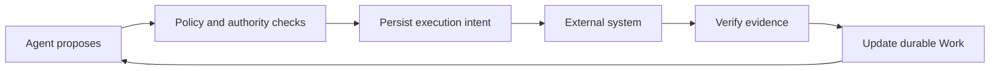

# Governed Work Runtime

**Let agents plan. Make every business action accountable.**

A small, durable runtime for work that must survive agent sessions and prove its results. Agents propose actions; policies gate execution; evidence establishes completion.

[中文](README.zh-CN.md) · [Architecture](docs/RFC-001-core-semantics.md) · [Protocol](docs/RFC-003-runtime-protocol.md) · [Verification](docs/verification.md) · [Contributing](CONTRIBUTING.md)

**Status: local reference prototype, pre-alpha.** Python 3.9+, Apache-2.0, zero runtime dependencies. The included expense policy and OA adapter are demonstrations. No hosted service, model API key or external account is needed.

## See it recover from a real crash

```bash
git clone https://github.com/WayJ/governed-agentic-work-runtime.git
cd governed-agentic-work-runtime
python3 -m work_runtime demo
```

The demo creates fresh temporary databases, starts a separate worker, and deliberately terminates it after the external service has committed. Restarting the runtime queries the original operation and recovers its receipt.

```text
1. Agent proposes submission → BLOCKED by E05 (approval missing)
2. Work waits durably; no model session needs to stay alive
3. Finance approves current content → submission intent accepted
4. OA accepts → worker exits before saving the response (real process crash)
5. Restart → query original operation → existing OA receipt recovered
6. Evidence-backed completion → SUCCEEDED; external applications created: 1
```

The final line is asserted against a separate persistent fake OA database. The demo prints an `inspect` command for the saved work and event history. Every run creates a new directory; it does not overwrite previous runs.

## Why a Work Runtime?

A business task can outlive its conversation. Its plan can change, approval can arrive days later, and a timed-out API request may already have created a real application.

This project keeps the responsibility, constraints and evidence in a persistent **Work**. The agent can choose a strategy while the runtime enforces the accepted rules around its actions.



Three distinctions shape the implementation:

| Distinction | Practical result |
|---|---|
| Work vs. plan | Removing a step cannot remove the requirement for approval |
| Command vs. operation vs. attempt | Lost responses and retries retain the original business identity |
| Execution vs. proof | A completed tool call cannot establish a business result without matching evidence |

## What works today

- Persistent work state, version checks, immutable command receipts and append-only change events.
- Independent deduplication of command requests, source events and logical business operations.
- Version-bound approval and confirmation; unknown amounts and incomplete invoice sets block submission.
- Evidence intake followed by verification; adoption and requirement evaluation commit together.
- Durable waits, early event handling, explicit expiry and restart recovery.
- Dispatch-time authority checks, held or cancelled unstarted intents, and reconciliation of uncertain outcomes.
- A persistent fake OA that enforces invoice uniqueness across different works.
- A replaceable `Policy` interface and an `Adapter` interface for execution and lookup.

The core API is a trusted, in-process library. Application code supplies source identities and grants; these names do **not** authenticate remote callers. The coordinator is local, and the prototype does not implement distributed worker leases, policy publishing, evidence revocation, cancellation/compensation, or multi-tenant authorization. Unsupported lifecycle commands are rejected explicitly. Full RFC coverage is tracked in [verification](docs/verification.md).

## Use the local API

This example uses helpers from the demonstration. `prerequisites` simulates trusted verification, user confirmation and finance approval; a real integration must obtain these from its authenticated sources.

```python
from work_runtime import ExpensePolicy, Runtime
from work_runtime.adapters import FakeOA
from work_runtime.demo import action, demo_grants, initialize, prerequisites, send

runtime = Runtime(".runtime/work.sqlite", ExpensePolicy(), demo_grants())
oa = FakeOA(".runtime/oa.sqlite")

initialize(runtime, work_id="expense-1")
prerequisites(runtime, work_id="expense-1")
receipt = action(runtime, work_id="expense-1")

assert receipt["decision"] == "accepted"  # Intent persisted; external execution is pending.
runtime.dispatch(receipt["operation_id"], oa)
completion = send(runtime, "expense-1", "request_completion")
assert completion["decision"] == "accepted"
```

`initialize` is for creating a new work once. After restarting, read the existing work and call `runtime.recover(oa)` to verify pending evidence and reconcile operations. Queries returning no authoritative external result cause intervention rather than blind resubmission.

## Run the tests

```bash
python3 -m unittest discover -s tests -v
```

Tests exercise actual subprocess death after external acceptance and during evidence adoption, concurrent duplicate commands, stale approvals, cross-work uniqueness, wait expiry and missing query results. See [the verification report](docs/verification.md) for implemented and deferred protocol cases.

Optional editable installation:

```bash
python3 -m pip install -e .
work-runtime demo
```

## Where this is going

The next milestone is a trustworthy developer integration boundary: authenticated adapter inputs, declared external capabilities, and documented examples for an agent harness. The following milestones address cancellation and compensation, policy authoring, and distributed execution based on measured needs.

The [roadmap](docs/roadmap.md) uses observable acceptance criteria. Contributions that challenge a guarantee with a reproducible failure are especially useful. Start with [CONTRIBUTING.md](CONTRIBUTING.md) and the [protocol cases](docs/RFC-003-runtime-protocol.md).
