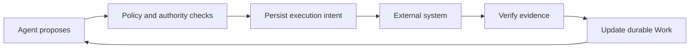

# Governed Work Runtime

**Let agents plan. Make every business action accountable.**

A small, durable runtime for work that must survive agent sessions and prove its results. Agents propose actions; policies gate execution; evidence establishes completion.

[中文](README.zh-CN.md) · [Architecture](docs/RFC-001-core-semantics.md) · [Protocol](docs/RFC-003-runtime-protocol.md) · [Verification](docs/verification.md) · [Contributing](CONTRIBUTING.md)

**Status: local reference prototype, pre-alpha.** Python 3.9+, Apache-2.0, zero runtime dependencies. The included expense and content-publication policies, and their OA/publisher adapters, are demonstrations. No hosted service, model API key or external account is needed.

## See it recover from a real crash

```bash
git clone https://github.com/WayJ/governed-agentic-work-runtime.git
cd governed-agentic-work-runtime
python3 -m work_runtime demo
```

The demo creates fresh temporary databases, starts a separate worker, and deliberately terminates it after the external service has committed. Restarting the runtime queries the original operation and recovers its receipt.

```text
1. Agent proposes submission → BLOCKED by E05 (approval missing)
2. Work waits durably; no model session needs to stay alive
3. Finance approves current content → submission intent accepted
4. OA accepts → worker exits before saving the response (real process crash)
5. Restart → query original operation → existing OA receipt recovered
6. Evidence-backed completion → SUCCEEDED; external applications created: 1
```

The final line is asserted against a separate persistent fake OA database. The demo prints an `inspect` command for the saved work and event history. Every run creates a new directory; it does not overwrite previous runs.

## Watch signed evidence gate a publication

```bash
python3 -m work_runtime publish-demo
```

A second business domain runs on the same Runtime class in its own database. Reviewer approval and author confirmation arrive as HMAC-signed envelopes: a tampered approval is rejected before any intake write, valid signatures still only create candidates until verification, and a publish call that times out after the external commit is recovered by querying the same operation — never resubmitted.

```text
1. Agent proposes publication → BLOCKED by C02 (reviewer approval missing)
2. Tampered reviewer approval → rejected EVIDENCE_AUTHENTICATION_FAILED before any intake write
3. Valid signed approval/confirmation stay candidates until verified → intent accepted
4. Publisher commits, response times out → outcome unknown, artifact exists
5. Restart → query the same operation → receipt recovered, nothing resent
6. Evidence-backed completion → SUCCEEDED; published artifacts: 1
```

The final line is asserted against the separate publisher database (`publications` table), and the printed command `inspect --policy content-publish` reads back the saved work and events. The signature proves source authenticity and content integrity only — not business truth; see [signed evidence](docs/signed-evidence.md).

## Watch interventions stop work without losing effects

```bash
python3 -m work_runtime intervention-demo
```

Three intervention scenarios run on the same Runtime class, each against its own fresh pair of databases: an ownership transfer that invalidates the prepared intent and denies the former owner (including replaying an already-accepted command), a cancellation that cannot complete while an external effect is uncertain — reconciling the original business key recovers exactly one effect, and closing requires acknowledging exactly that effect — and an explicit same-family policy migration that invalidates the old approval, strengthens the approval rule and re-admits the same operation once version-bound approval arrives.

```text
Scenario A — ownership transfer (own store: transfer/)
1. Agent proposes submission → intent prepared while agent owns the work
2. transfer_owner agent → delegate → prepared intent invalidated (OWNERSHIP_TRANSFERRED)
3. Former owner re-proposes → AUTHORITY_DENIED; replays the accepted command → fresh AUTHORITY_DENIED, stored receipt untouched; dispatch stays cancelled (0 external calls)
4. New owner re-proposes → SAME operation id (business key stable) → intent readmitted
5. Dispatch → confirmed_succeeded; accepted applications in this store: 1

Scenario B — cancellation with an uncertain external effect (own store: cancel/)
1. Agent proposes submission → intent prepared
2. Dispatch → OA accepted, response lost after commit → outcome unknown (the effect exists)
3. request_cancel → intent stored; finalize now → OUTCOME_UNRESOLVED while the effect is unknown
4. Reconcile the ORIGINAL business key → confirmed_succeeded, external id recovered, nothing resent
5. finalize [] → CANCEL_ACKNOWLEDGEMENT_MISMATCH; exact acknowledgement [op] → CLOSED cancelled
6. Acknowledgement records the effect (no reversal); accepted applications in this store: 1

Scenario C — explicit policy migration demo-1 → demo-2 (own store: migrate/)
1. Under-limit expense bound to demo-1 → E05 not applicable; a demo-1-shaped approval exists
2. work.intervene admin migrates to demo-2 → revision 2; old approval INVALID; E05 applicable + pending; prepared intent invalidated (POLICY_MIGRATED)
3. Re-propose → REQUIREMENT_UNSATISFIED; stale contract revision → CONTRACT_REVISION_MISMATCH
4. Finance approves under demo-2 ({digest, policy_version}) → E05 satisfied → SAME operation readmitted
5. Restart without the registry → fails closed; restart with the registry → pinned demo-2 usable
   (restart without the registry: Load the policy version bound to this Work; migration is not implicit)
6. Dispatch → confirmed_succeeded; accepted applications in this store: 1

3 scenarios; accepted applications: 3 (one per store); effects reversed: 0
```

Every count is asserted against the scenario's own external database: zero external calls while the intent is merely prepared or cancelled, exactly one accepted application after each external acceptance. Closing a cancelled work records the acknowledged effect with its external id — acknowledgement is durable bookkeeping, not compensation; nothing is reversed. The owners, delegates and administrators in the grants map are trusted local principals, not authenticated identities. A work pinned to `demo-2` is readable only with its version registry loaded — the printed `inspect --policy-versions demo-1,demo-2` command does exactly that; without the flag, inspection fails closed.

## Adopt it: lint a rule card, publish a real file

```bash
python3 -m work_runtime adoption-demo
python3 -m work_runtime lint-sop work_runtime/data/sop/publishing.json
```

The fourth demonstration is the adoption path a new contributor takes. The static prologue lints SOP rule cards — an invalid card yields bounded diagnostics, the two packaged cards lint clean with their exact SHA-256 content digests — and states plainly that linted JSON is never executed. The live part then runs the unchanged Runtime and publication policy with HMAC-signed reviewer/author evidence and the third adapter, `FilePublisher`: after approval and verification, a real hash-named JSON artifact is committed to a fresh directory, the response is then lost (a composition wrapper raises after the real commit), and a restarted Runtime recovers by querying the original business key — never resubmitting.

```text
1. Invalid demo card -> 3 diagnostics, first EMPTY_VALUE at /policy/goal (lint-sop exit 1)
2. Packaged cards lint-clean with exact content digests (lint-sop exit 0)
3. Agent proposes publication -> BLOCKED by C02 (reviewer approval missing)
4. Tampered reviewer approval -> rejected EVIDENCE_AUTHENTICATION_FAILED before any intake write
5. Valid signed approval/confirmation stay candidates until verified -> intent accepted
6. FilePublisher commits a real hash-named artifact; response lost AFTER the commit -> outcome unknown
7. Restart -> reconcile the ORIGINAL business key -> confirmed_succeeded, nothing resent
8. Evidence-backed completion -> SUCCEEDED; committed file artifacts: 1
```

The final count is asserted against the actual publisher directory (exactly one `[0-9a-f]{64}.json` file), and the printed `inspect` command and artifact path work verbatim. `lint-sop` exits 0 clean / 1 diagnostics / 2 file errors (duplicate object keys, non-finite literals, invalid UTF-8, malformed JSON, unreadable or >1 MiB files are all exit 2 and never echo file contents); `--json` prints the exact static-only result envelope. Linting is structural review only — no textual predicate is executed and no publication authority is conferred. To extend the runtime yourself — a third-party-style adapter through the public conformance tests, or a reviewed rule card — see the [contributor guide](docs/contributor-guide.md).

## Browse it: a local read-only GUI

```bash
python3 -m work_runtime ui-demo                                   # seed a five-work sample, then serve it
python3 -m work_runtime ui --db <existing-runtime.sqlite>         # serve an existing store
```

The command prints the actual loopback URL and serves until `Ctrl-C`. The page is an offline, dependency-free bilingual (English/Chinese) viewer over what the store actually recorded: metric tiles with definitions, a searchable/filterable work list, and per-work detail covering current requirements, evidence, operations with attempts, persisted command decisions, the keyset-paginated event timeline and the exact stored documents as text. Stored payloads are rendered as text only — never parsed, never executed — and string-encoded integers keep their exact digits. `ui-demo` seeds its five-work sample (waiting, needs-attention with a retained external effect, transferred, succeeded, cancelled-with-acknowledged-effect) through real commands and the real FakeOA; see the [GUI guide](docs/gui.md). The viewer opens stores read-only on loopback; that binding is convenience, not authentication. Serving needs the read-only backend module assembled in the install — without it the `ui` commands exit 2 with a bounded message and every other command keeps working.

## Why a Work Runtime?

A business task can outlive its conversation. Its plan can change, approval can arrive days later, and a timed-out API request may already have created a real application.

This project keeps the responsibility, constraints and evidence in a persistent **Work**. The agent can choose a strategy while the runtime enforces the accepted rules around its actions.



Three distinctions shape the implementation:

| Distinction | Practical result |
|---|---|
| Work vs. plan | Removing a step cannot remove the requirement for approval |
| Command vs. operation vs. attempt | Lost responses and retries retain the original business identity |
| Execution vs. proof | A completed tool call cannot establish a business result without matching evidence |

## What works today

- Persistent work state, version checks, immutable command receipts and append-only change events.
- Independent deduplication of command requests, source events and logical business operations.
- Version-bound approval and confirmation; unknown amounts and incomplete invoice sets block submission.
- Evidence intake followed by verification; adoption and requirement evaluation commit together.
- Durable waits, early event handling, explicit expiry and restart recovery.
- Dispatch-time authority checks, held or cancelled unstarted intents, and reconciliation of uncertain outcomes.
- A persistent fake OA that enforces invoice uniqueness across different works.
- HMAC-signed evidence ingress: strict envelopes, per-source keys, freshness and tampering rejected before any write; the reserved `accepted` kind cannot be supplied through ingress.
- Declared adapter contracts with reusable conformance tests and dispatch-time capability checks.
- A second business domain (content publication) on the same Runtime: review gating, content-bound evidence and one published artifact per `(document id, content digest)`.
- Ownership transfer, cancellation and explicit same-family policy migration: prepared intents are invalidated with recorded reasons, uncertain effects must reconcile before cancellation completes, and closing requires acknowledging the exact set of succeeded effects with their external ids — recorded, never reversed.
- An explicit per-runtime policy registry: works stay pinned to their bound version, restarts fail closed until that version is loaded, and migration revalidates every piece of evidence under the target policy before binding changes.
- Static SOP rule-card linting with deterministic diagnostics and exact content digests (`lint-sop`, packaged example cards shipped inside the package) — structural review only, never executable authority.
- A third, real-filesystem adapter (`FilePublisher`): one immutable hash-named JSON artifact per idempotency key, committed atomically, queryable after restart — plus the no-credentials adoption harness above.
- An offline read-only operations GUI (`ui`/`ui-demo`): bilingual light interface over durable records — tiles, searchable list, requirements/evidence/operations/decisions/events/documents detail, exact stored JSON as text — with a real-command five-work sample seed and packaged assets.
- A replaceable `Policy` interface and an `Adapter` interface for execution and lookup.

The core API is a trusted, in-process library. Application code supplies source identities and grants; these names do **not** authenticate remote callers — owners and `work.intervene` administrators are trusted local principals, not authenticated identities. The signed ingress authenticates evidence sources within a configured shared-key boundary — it is not transport security, tenant authorization, or proof of business truth. One policy family owns each runtime database; works may pin different versions of that family through an explicitly loaded registry, and the two demo domains use separate databases on the same Runtime class. The coordinator is local, and the prototype does not implement distributed worker leases, policy publishing, evidence revocation, compensation (effect reversal) execution, or multi-tenant authorization: cancelling a work acknowledges its external effects, it does not undo them. Unsupported lifecycle commands are rejected explicitly. Full RFC coverage is tracked in [verification](docs/verification.md).

## Use the local API

This example uses helpers from the demonstration. `prerequisites` simulates trusted verification, user confirmation and finance approval; a real integration must obtain these from its authenticated sources.

```python
from work_runtime import ExpensePolicy, Runtime
from work_runtime.adapters import FakeOA
from work_runtime.demo import action, demo_grants, initialize, prerequisites, send

runtime = Runtime(".runtime/work.sqlite", ExpensePolicy(), demo_grants())
oa = FakeOA(".runtime/oa.sqlite")

initialize(runtime, work_id="expense-1")
prerequisites(runtime, work_id="expense-1")
receipt = action(runtime, work_id="expense-1")

assert receipt["decision"] == "accepted"  # Intent persisted; external execution is pending.
runtime.dispatch(receipt["operation_id"], oa)
completion = send(runtime, "expense-1", "request_completion")
assert completion["decision"] == "accepted"
```

`initialize` is for creating a new work once. After restarting, read the existing work and call `runtime.recover(oa)` to verify pending evidence and reconcile operations. Queries returning no authoritative external result cause intervention rather than blind resubmission.

## Verify a checkout

```bash
python3 -m unittest discover -s tests -v             # tests gate
python3 scripts/check_docs.py                        # contracts gate: local doc links resolve
python3 -m work_runtime demo                         # demo gate: real crash recovery
python3 -m work_runtime publish-demo                 # demo gate: signed-evidence publication
python3 -m work_runtime intervention-demo            # demo gate: transfer, cancel, migrate
python3 -m work_runtime adoption-demo                # demo gate: lint + file-adapter adoption
python3 -m compileall -q work_runtime tests scripts  # syntax gate
python3 scripts/verify_install.py                    # fresh venv, install, demos outside the checkout
```

The first seven commands are the repository's gates. `scripts/verify_install.py` goes further: it builds the package into a brand-new virtual environment, asserts the import comes from that venv rather than the checkout, checks that no third-party dependency was installed, and runs the demos with the working directory outside the repository — counting exactly one external application in the fake OA database, exactly one publication in the publisher database, exactly one accepted application per intervention store, and, for both the module and console entry points of `adoption-demo`, independently enumerating and parsing exactly one committed hash-named file artifact (digest, receipt, business key and work outcome re-verified with the standard library only) rather than trusting the printed output. It also confirms the packaged SOP cards and GUI web assets ship inside the install and the installed `lint-sop` reproduces the pinned digest; when the read-only UI backend module is present in the install it additionally drives the installed `ui-demo`/`ui` entry points as real subprocesses over real HTTP (asset byte-equality, the five seeded works, store tables unchanged, clean interrupt) and otherwise prints an explicit SKIPPED line. The install stage needs pip index access for the build backend.

Tests exercise actual subprocess death after external acceptance and during evidence adoption, concurrent duplicate commands, stale approvals, cross-work uniqueness, wait expiry and missing query results. See [the verification report](docs/verification.md) for implemented and deferred protocol cases: 14 of the 15 protocol acceptance cases are covered by named tests, and P13 (distributed worker leases) is explicitly deferred.

Optional editable installation:

```bash
python3 -m pip install -e .
work-runtime demo
```

## Where this is going

The integration-boundary milestone now has a local slice: HMAC-authenticated evidence intake, declared adapter capabilities with conformance tests, and a second-domain harness through the same command protocol. What remains before calling it trustworthy is external review and real adapter experience. The intervention milestone likewise has a local slice — cancellation with exact effect acknowledgement, authority-aware ownership transfer, and explicit same-family policy migration — while compensation execution, evidence revocation and distributed fencing stay open. The authoring-and-adoption milestone has its local slice too: static rule-card linting, a real filesystem adapter and the [contributor guide](docs/contributor-guide.md) — while rule-card publication authority, semantic compilation and collected external author feedback remain open. Later milestones address distributed execution based on measured needs.

The [roadmap](docs/roadmap.md) uses observable acceptance criteria. Contributions that challenge a guarantee with a reproducible failure are especially useful. Start with [CONTRIBUTING.md](CONTRIBUTING.md) and the [protocol cases](docs/RFC-003-runtime-protocol.md).
