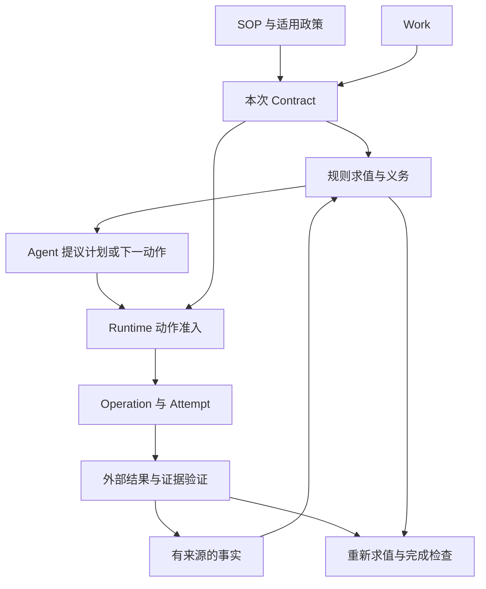

# RFC-001：受治理的智能体工作体系——领域模型与执行语义

版本：0.1 · 日期：2026-10-13 · 状态：草案，供讨论与反例检验

> 实现状态（2026-10-13）：本地参考原型已实现并通过命名测试覆盖 R1–R7 对应协议验收项 P01–P15 中的 14 项；P13（分布式租约）明确延期。逐项状态与证据见[验证覆盖](verification.md)。本文仍为候选设计，不构成已发布规范。

背景：[最初构想](../idea.md)、[上次建议](../上一次建议.md)。配套：[参考场景与执行轨迹](reference-scenarios.md)。

本文把历史讨论中的建议视为设计输入，不视为已获确认的决策。本文提出的是项目自身的候选语义，不是对现有标准或产品能力的综述。

标记约定：**P（原则）**是希望系统保证的性质；**H（假设）**是需要检验的抽象；**D（暂定决策）**是本草案为便于推演采用的方案，尚待评审；**Q（开放问题）**是尚未解决的问题。

## 1. 问题与边界

系统管理的是一项被委托的业务工作：在明确的权限和业务约束下，持续采取行动，并以可接受的证据证明目标达成。工作可以跨越多个 Agent 会话、人工参与和外部系统等待。

**P1：Work 独立于会话和计划存在。** 会话终止、计划替换或执行者更换，都不能抹去工作责任和已经发生的业务效果。

**P2：计划不是授权，动作成功不是业务完成。** 计划审查、动作准入和结果验证必须分别表达。

**P3：未知不能当成通过。** 缺失信息或相互冲突的证据，不能使依赖它们的约束自动消失。

**P4：所有受治理的副作用都必须经过可执行的控制边界。** 如果 Harness 仍持有可绕过 Runtime 的写凭据，该系统只能提供建议与观察，不能声称强制治理。

本阶段定义对象、状态变化和拒绝条件，不确定数据库、部署形态、框架或 SOP 文件语法。也不承诺任意自然语言规则都能自动形式化、所有目标一定可达或任意外部系统都能保证恰好一次执行。

初步验收要求：

| 编号 | 可检查的行为 |
|---|---|
| R1 | 会话关闭并重启 Runtime 后，能够从持久状态继续等待或执行 |
| R2 | 从计划中删去审批步骤，不能删除相应业务要求 |
| R3 | 规则条件未知时，受影响的提交操作不能获得准入 |
| R4 | 外部提交超时后，不把结果当作失败并盲目重试 |
| R5 | 确认后的单据内容变化时，旧确认不能覆盖新内容 |
| R6 | 重复或迟到的回调不能重复提交，也不能复活已关闭工作 |
| R7 | 没有剩余计划步骤但缺少目标证据时，不能标记成功 |

## 2. SOP 的规范语义

**D1：SOP 同时允许声明式要求与必要的程序约束，并明确区分强制规则和建议。**

| 内容 | 例子 | Runtime 的责任 |
|---|---|---|
| 目标模板 | 正式提交报销申请 | 实例化为本次可验证目标 |
| 不变量／禁止条件 | 未获授权不得提交 | 每次相关动作准入时检查 |
| 条件义务 | 超额度需要特别批准 | 根据事实求值、保留依据 |
| 强制先后关系 | 审批必须针对最终确认版本 | 检查对象版本和事件顺序 |
| 决策规则 | 根据城市、职级计算额度 | 使用指定规则或有权裁决者 |
| 验收要求 | OA 正式受理当前版本单据 | 检验证据是否覆盖目标 |
| 建议流程 | 优先并行读取发票与差旅信息 | 供 Planner 选择，不作为授权 |

不能把所有规则都转成“最终存在某个证据”。例如“提交前须批准”是历史顺序约束；先提交再补批不能被解释为从未违规。

**D2：自然语言 SOP 的加载与生效分开。** Agent 可以抽取规范候选、发现歧义；只有经业务发布机制认可的版本，才成为运行依据。暂时不能形式化的判断可以委托给指定人工或服务，并要求留下裁决范围和证据。不能把“LLM 解释了规则”直接当成“企业发布了规则”。

规范发布至少需要说明：适用范围、强制与建议分类、判断责任主体、可接受证据、版本与生效条件。Skill 是发现和分发这些内容的一种载体；加载 Skill 本身不授予业务权限。

**Q1：业务人员如何审阅抽取结果并维护规则？** [RFC-002：SOP 的表达、发布与实例绑定](RFC-002-sop-authoring-and-binding.md) 提出规则卡、发布检查和示例判例，尚待作者试用与实现验证；不能隐含交给运行中的 Planner。

## 3. 最小领域模型

**H1：Work、Contract、Obligation、Plan 的区分有用，但不需要立即成为四个服务或四张表。**

| 概念 | 语义与边界 | 变化方式 |
|---|---|---|
| Work | 某主体委托的具体工作，含身份、目标、责任归属和生命周期 | 稳定 ID，状态带版本 |
| Contract | 本次目标、规范绑定、权限边界、验收与修订条件 | 发布实例修订版，保留历史 |
| Fact | 关于业务对象的断言，含来源、对象版本、观察时间和适用时间 | 追加断言、更正和失效关系 |
| Obligation | 规则针对本次对象产生的要求，含触发依据和履行判据 | 条件及证据变化后重新求值 |
| Plan | 履行要求、补齐信息的当前策略，允许只规划近期动作 | 提议、审查、激活新修订版 |
| Operation | 一次逻辑业务操作，如提交某个版本的申请 | 稳定操作 ID，保留外部关联 |
| Attempt | Operation 的一次实际调用尝试 | 每次调用独立记录 |
| Evidence | 可被引用和验证的材料或记录 | 保留原件引用与验证结论版本 |
| Wait | 等待对象、匹配条件、期限及超时处置 | 持久注册、触发、取消或升级 |

Work Item 暂作为 Plan 内的组织单位；Authority 是动作准入的输入；Ledger 是状态变化历史。这些语义必须存在，但本阶段不要求全部做成独立资源。

与之前讨论相比，这里刻意拆出 Operation 与 Attempt。一次创建申请的 HTTP 调用超时，不意味着应该创建一个新的业务操作；重试次数也不能定义业务身份。

Contract 可以先作为 Work 内部的版本化数据。它的独立价值在于：Planner 不能通过改计划来改目标、规范绑定或验收条件。若这一边界能被更简单的数据结构保证，可以合并存储，保留语义区分即可。



该图描述依赖关系。外部证据可以直接到达，不要求必须由当前计划中的 Action 产生。

## 4. 事实、义务与证据

### 4.1 规则求值不能只有真与假

**D3：条件求值区分 true、false、unknown、conflict。** unknown 表示信息不足；conflict 表示适用来源间存在未解决矛盾。二者都不能当作 false。

例如 `amount > limit`：金额未确定时，不能断言特别审批不适用。可继续读取金额、验证发票等允许的信息获取动作，但不能越过依赖额度判断的提交关口。

义务至少区分两个维度，避免把所有情况塞进单个状态枚举：

| 维度 | 候选值 |
|---|---|
| 适用性 | unknown / applicable / not_applicable / conflict |
| 履行情况 | pending / satisfied / waived / violated |

`waived` 只在规则明确允许且存在有效豁免证据时成立；`not_applicable` 需要条件为假的依据。执行中、等待中属于工作调度情况，不直接代表义务履行情况。

义务身份绑定规则、目标业务对象及适用范围；重复求值更新同一要求的评估记录。对象更换或规则迁移时建立显式关联，不能不断生成不相干的新义务，也不能删除旧历史。

### 4.2 证据必须与它证明的对象匹配

候选的验证输入包括：证据来源、业务对象与版本、证明的命题、适用期间、验证规则版本、撤销情况，以及需要时的人工裁决身份。

**P5：Agent 的高置信度不能替代业务授权或指定证明来源。** LLM 可以被指定为某种低风险判断的评估者，但接受范围与失败处置必须来自规范。

例如，确认记录必须绑定用户看到的单据内容版本或摘要。改变金额、收款方或发票集合后，必须重评确认有效性；不能只读取 `user_confirmed = true`。

证据撤销、事实更正或规范迁移可以使当前 `satisfied` 回到 `pending`。历史上曾被判为满足的记录仍保留。顺序约束已经违反时，后补证据不能清除违规事件。

**Q2：证据验证如何保证质量？** Runtime 保证调用指定验证者、保留依据和执行阻断；不能凭架构本身保证验证者对现实世界永远判断正确。

## 5. Work 如何推进

**D4：Runtime 管理已接受的业务状态；Agent 提出状态变化所需的命令和证据。** 外部业务系统仍是其业务记录的权威来源，Runtime 的状态是有依据、可能滞后的已知状态。

一次推进可概括为：

```text
接收命令或外部事件
→ 核验身份、关联、重复与状态版本
→ 接受事实或证据，重新求值受影响要求
→ 选择继续确定性执行 / 请求规划 / 等待 / 人工处置 / 完成检查
→ 持久化状态变化和需要派发的执行意图
```

该循环不要求每个事件都调用 LLM，也不要求先生成完整工作流。缺少适用政策所需的信息时，Work 可以先处于建立阶段，只允许事先获准的初始化操作；不能以“尚未绑定规则”为由放开业务写入。

### 5.1 计划审查与动作准入

计划审查检查已知约束、依赖、范围和待处理缺口，不证明未知未来中的每一步必然合法，也不证明计划一定能完成。

部分计划必须指出当前处理哪些要求、哪些缺口被保留、何时再次规划或升级。永久忽略某项义务不能仅靠“尚未规划”掩盖；由期限、责任人和无进展策略识别。

对一个即将派发的动作 a，候选准入条件为：

```text
Admit(a, S) =
  WorkAllowsAction(S)
  AND ScopeMatches(a, Contract)
  AND PreconditionsVerified(a, S)
  AND AuthorityValid(a, S)
  AND RequiredApprovalsMatchPayload(a, S)
  AND NoRelevantBlockingViolation(a, S)
  AND OperationIsSafeToDispatch(a, S)
```

每个条件都必须明确通过；unknown 或 conflict 不等于通过。阻断范围取决于规则依赖，不能因一张发票待核验就禁止所有独立的信息读取。

动作应携带 `work_id`、读取的状态版本、Contract／Plan 修订、业务对象版本、参数摘要、Operation ID，以及依据引用。准入记录绑定这些输入；内容变化后不可复用旧记录。

### 5.2 并发与授权时效

**D5：对同一 Work 的冲突状态提交必须串行化或进行版本比较。** 两个 Agent 基于同一版本提交互斥修订时，只能接受一个，另一个读取新状态后再提议。

状态提交和待派发意图必须具有原子一致性或等价的恢复保证。派发前重新检查关键授权、对象版本及撤销状态；已过期的准入不能无限期复用。

外部系统执行瞬间的授权撤销竞态，若没有外部条件写入或共同授权机制，Runtime 无法完全消除。必须明确外部提交边界及残余风险；不能宣称本地锁解决跨系统原子性。

跨 Work 的重复报销同样不能只靠 Work 内锁解决。预检查用于早期发现，真正防止并发重复需要外部唯一约束、预留机制或可协调的共享业务键。缺乏这种能力时，标为已知限制并交由业务策略决定是否接受。

## 6. 外部效果、等待与恢复

Operation 的候选状态为 `prepared / dispatched / outcome_unknown / confirmed_succeeded / confirmed_failed`。Attempt 记录传输结果；HTTP 超时只说明该次观察失败，不能证明业务失败。

**D6：任何可能已发生的副作用，都必须在重试前核实或使用外部认可的幂等语义。**

| 故障位置 | 恢复行为 |
|---|---|
| 执行意图尚未提交 | 不应发生外部调用；重新从当前状态判断 |
| 意图已提交，派发结果不明 | 读取持久记录，按未知结果处理 |
| 外部成功，本地未记结果 | 通过相同业务键查询或安全幂等重放 |
| 外部确认失败且无效果 | 在仍获准时为同一 Operation 创建新 Attempt |
| 无查询、无幂等能力且结果不明 | 保留 outcome_unknown，进入人工核实 |

幂等键绑定逻辑操作及确定的内容，不能每次重试都换新键，也不能用同一键提交不同内容。外部幂等有效期过后，不自动认为再次重放安全。

**D7：等待是一条持久记录，而不是一个挂起的模型调用。** 它至少包含对象关联、预期事件、版本／摘要、期限、超时处置和责任主体。

注册等待与发起外部请求之间不能丢事件：需先持久化可关联意图，并允许提前到达的回调持久收件、稍后匹配。具体使用事务收件箱、发件箱或持久执行设施，留给实现阶段。

外部回调要验证来源、作用对象与业务状态。重复消息按事件标识或稳定业务关联去重；乱序消息根据外部版本或重新查询处理，不能按接收时间盲目覆盖。

Runtime 重启后从持久状态恢复未完成意图、等待、定时器及核实任务；Agent 按需领取当前工作摘要。不要求恢复原会话的全部文本。

## 7. 动态修订与生命周期

**D8：计划修订、Contract 修订和外部补偿是不同操作。**

| 变化 | 处理 |
|---|---|
| 更换尚未执行的验证方式 | 计划修订，检查新证据方式是否被允许 |
| 更换发票或修改金额 | 接受新对象版本，重评相关证据、确认与计划 |
| 从“提交申请”改为“收到款项” | Contract 修订，重新评估权限、验收与责任 |
| 企业发布新政策 | 根据生效与迁移规则判断，不能仅按最新版覆盖 |
| 已创建申请需要撤回 | 创建真实的撤回 Operation，并验证外部结果 |

计划修订协议：提议并注明基线 → 检查约束与受影响对象 → 检查在途 Operation → 接受新修订并停用未派发的旧意图 → 重新准入后续动作。结果未知的操作必须继续核实，不能因为旧计划停用而遗忘。

政策绑定保存规则版本、适用时间依据和迁移策略。费用标准可以按发生日选择；执行权限需在动作时验证。规则冲突不能交给 Agent 自行选择较宽松版本，先按已发布优先级处理，否则升级裁决。

建议的工作状态：`establishing / active / waiting / needs_attention / closed`。关闭另记结果：`succeeded / rejected / cancelled / failed`，避免把业务拒绝和运行故障混为一谈。

有仍可执行的独立工作时保持 active；仅在没有可执行工作且存在有效等待时进入 waiting。无可执行工作也无可唤醒等待时进入 needs_attention，附责任人和原因。重试、规划轮数、截止时间与无进展上限由 Contract 或运行策略给出。

取消请求立即阻止新的相关副作用，但不能假设在途调用已撤销。完成核实与必要撤回，或经明确授权把剩余处置责任转移到可追踪的后续 Work，才可关闭为 cancelled。

## 8. 完成语义

**D9：成功关闭是对某一业务状态版本的一次验收决定。**

```text
CanSucceed(W, S) =
  GoalProven(S)
  AND ApplicabilityResolvedForCompletionScope(S)
  AND EveryApplicableRequiredObligationDischarged(S)
  AND NoBlockingViolation(S)
  AND NoUnresolvedRelevantExternalEffect(S)
```

义务履行只能由有效满足证据或被允许的有效豁免证明。完成范围内还有未知适用条件时，不能靠“当前义务列表为空”通过验收。

成功提交、审批通过、款项到账是不同目标。本文场景中的“完成”始终相对于 Contract 指定的目标，不推断后续结果。

验收决定绑定状态版本、规范绑定与证据引用，并与关闭状态一致提交。随后到达的新证据不能改写当时的决定。若发现原验收依据错误，追加纠正记录并按政策建立关联整改 Work；本草案暂不自动重开原 Work。

## 9. Agent 与 Runtime 的职责

| 事项 | Agent | Runtime／指定责任主体 |
|---|---|---|
| 理解用户意图 | 提出目标和缺失信息 | 检查目标绑定与必要授权 |
| 解释自然语言 SOP | 提出规范候选与歧义 | 发布者批准规范，运行时加载有效版本 |
| 制订计划 | 选择策略，提出修订 | 审查约束，保留版本，执行准入 |
| 获取材料 | 在权限内调用或请求获取 | 控制访问范围，记录来源 |
| 判断证据 | 提取信息，执行被委托的评估 | 指定验证者裁决，记录结论 |
| 请求执行 | 提议具体动作 | 管理意图、调用、幂等与核实 |
| 长期等待 | 说明等待什么 | 保存等待、接收事件、调度恢复 |
| 宣告完成 | 提议验收 | 按完成条件关闭 Work |

Runtime 的确定性在于遵守明确的状态转换和决策程序，不意味着每一个业务判断都必须由代码完成。人工判断也可以成为明确程序的一部分。

## 10. 替代方案与可证伪假设

| 路线 | 本项目中的候选价值 | 需要挑战的地方 |
|---|---|---|
| 以计划为中心 | 固定程序容易表达和追踪 | 换计划时是否容易丢失业务责任 |
| 以义务为中心 | 允许不同执行路径复用同一证明要求 | 如何管理顺序、资源和长期无进展 |
| 以 Contract 为中心 | 目标、权限与验收边界清楚 | 是否只是重复保存 SOP 与 Work 字段 |
| 以业务事项为中心并组合上述语义 | 支持长时状态与动态策略 | 是否引入过多独立对象和同步成本 |

**H2：Obligation 需要稳定身份。** 检验：已有证据复用、异常后重新求值、计划替换时，能否独立解释某项要求为何满足或未满足？若纯规则投影可满足全部审计与恢复需求，可以只物化部分记录。

**H3：Plan 是可选的执行组织形式。** 单步动作可以作为最小计划提议；长链任务才需要明确依赖结构。检验：去掉完整 Graph 后，三个参考场景能否仍被正确约束和恢复？

**H4：Contract 修订值得独立表达。** 检验：若所有修订都仅等同于一组 Work 字段版本变化，可合并实体；但不得合并授权与计划控制权。

当前场景仅是桌面推演，不能证明运行可靠性。下一轮应以假适配器注入崩溃、重复事件、乱序回调和旧版本命令，验证 R1–R7，再确定存储与协议。

## 11. 后续需要收敛的事项

1. 业务责任转移与人工接管：谁可接管、如何接受责任、何时算完成交接？
2. 规则求值范围：如何声明依赖、发现遗漏规则、保证终止并处理互相激活？首版可限定有限对象集合和无递归规则，复杂情况转人工。
3. 跨 Work 共享资源与批量任务：锁定、预留、撤销之间如何协调？
4. 证据保存与隐私：怎样在可审计、更正和数据保留要求之间建立具体策略？
5. 业务作者体验：自然语言与形式规则如何共同审阅、测试和发布？

SOP 优化应输出带事件与指标依据的变更提案，经审阅、场景回归后发布新版本；不能让运行中的 Agent 根据成功率自行降低约束。首批指标可围绕义务等待时间、结果未知持续时间、人工介入原因和计划修订原因建立。
