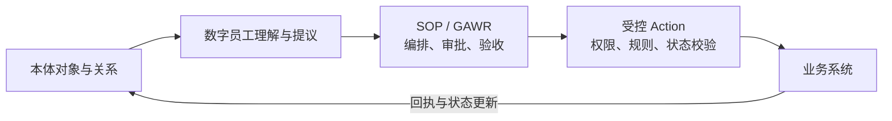

和 astra pro 沟通如下：

Q：

./城建AI本体决策引擎_架构设计.md

本体论的动作action，和我们目前dsh-saas 系统中开发的数字员工中的SOP，区别是什么？差异在哪里？哪一个设计好

A：

我的判断是：**对 dsh-saas，最好的设计是保留 SOP／GAWR 的流程治理，再补强本体对象和受控 Action。两者承担不同职责，可以组合。**

而且，对照代码后发现：**当前安全员数字员工的 SOP 里，已经有 Action 的实现思路了。**

按你这份文档的含义，可以这样区分：

- **本体：业务世界里有什么，它们是什么关系。**例如隐患发生在哪个部位、影响哪道工序、由哪个班组负责、关联哪笔款。
- **Action：允许对这些业务对象做什么改变。**例如创建整改单、正式派单、冻结付款、复核销号。
- **SOP：为了完成一件事，应该如何组织这些动作。**包括先后顺序、谁处理、谁审批、需要什么证据，以及失败后怎么继续。

| 比较项 | 本体中的 Action | 数字员工的 SOP |
|---|---|---|
| 核心问题 | 这次业务操作能否合法、正确地执行？ | 整件工作如何完成、如何验收？ |
| 主要组织对象 | 业务对象及其状态变化 | 步骤、人员、材料、依赖关系 |
| 典型例子 | 将通过复核的隐患正式销号 | 发现隐患→拟方案→审批→整改→复核→销号 |
| 约束重点 | 权限、业务规则、对象状态、幂等 | 顺序、职责分离、等待、返工、过程验收 |
| 复用方式 | 同一个动作供多个流程、界面调用 | 一个流程组合多个动作与人工判断 |
| 完成的含义 | 本次操作产生了可核实的业务效果 | 整项工作的必要环节全部完成 |

一个 Action 可以修改多个关联对象，不等于只能改一个字段。Palantir 官方对 Action 的定义也是一次事务内对对象、属性和关系的一组改变，并通过提交条件约束执行。[Action 定义](https://www.palantir.com/docs/foundry/action-types/overview/index.html)、[提交条件](https://www.palantir.com/docs/foundry/action-types/submission-criteria)

**拿我们正在做的安全整改来说，区别最清楚。**

当前安全员模板已经区分 `agent`、`human`、`action` 三类节点，并明确包含：

- `business.plan.create`：保存经过评阅的整改方案草案。
- `business.order.dispatch`：按照批准版本正式派单。
- `business.inspection.close`：根据独立复核结果正式销号。

这些动作已经写在[模板源码](/Users/jiangwei/.codex/worktrees/702c/dsh-saas/recipes/site-safety-officer/workflow/publish.py:128)中。整个 SOP 再把它们与 AI 分析、A/B 审批、C 整改、D 独立复核组织起来。

两层控制分别回答：

> **SOP／GAWR：现在是否到了销号这一步，所需复核是否完成？**  
> **销号 Action：当前调用者是否有权销号，这个隐患的最新状态及复核记录是否允许销号？**

两边都需要检查。即使有人从另一个界面调用销号，业务系统仍应维护自己的规则。

所以，我们已有的受控 SOP，并非只靠模型遵守文字要求。服务端已经核对审批人的真实身份、本轮证据，以及业务操作的权限与回执；结果未知时走原操作查询。[审批代码](/Users/jiangwei/.codex/worktrees/702c/dsh-saas/server/owndsh-modules/owndsh-enterprise/src/main/java/com/owndsh/enterprise/task/governed/WorkflowCommandService.java:78)、[业务执行代码](/Users/jiangwei/.codex/worktrees/702c/dsh-saas/server/owndsh-modules/owndsh-enterprise/src/main/java/com/owndsh/enterprise/task/governed/WorkflowNativeBusinessService.java:24)

这里需限定范围：这是**安全员岗位正在落地的受控流程**；其他岗位仍有旧式 SOP，安全员的真实 Harness、独立模型和完整部署验收也尚未完成。[当前状态](/Users/jiangwei/.codex/worktrees/702c/dsh-saas/recipes/site-safety-officer/README.md:58)

**你这份本体设计真正值得吸收的，是跨业务的统一语义。**

目前安全员流程主要围绕检查记录、方案、审批、整改单、反馈和复核组织工作。文档则进一步把：

> 空间部位 → 施工工序 → 分包班组 → 现场异常 → 成本与付款

关联起来。

这使系统有机会回答：“这次隐患除了需要整改，还会影响哪个后续工序、哪个分包的付款？”

**这种能力来自对象关系、数据质量和业务规则。**仅仅把 SOP 的步骤改名为 Action，不会获得这种能力；仅仅采用本体，也不会自动得到可靠的跨模块推演。

反过来，**当前 SOP／GAWR 在过程治理上的设计，比这份文档展开得更具体**：同版审批、不同人签认、驳回返工、证据冻结、未知效果查回、最终交付验收，都已有明确机制。本体文档主要写了“人批后执行”，对这些长流程细节还没有充分展开。

另外，文档有两处概念需要进一步收紧：

1. **§4.2 的“四大 Action”实际上更接近四个业务场景或子流程。**例如“签证／罚款自动算量计价”包含读取、计算、生成草稿和审批；落地时应拆成推理／计算步骤、人工节点和具体写入 Action。[原文位置](</Users/jiangwei/Documents/MyKnowbase/企业技术建设/本体论/城建AI本体决策引擎_架构设计.md:221>)
2. **§4.1 的 `actor_id` 只是身份标识，不能单独作为审批凭据。**真正执行时需要验证：谁以什么身份批准了哪个版本、哪些参数，执行时授权是否仍然有效。这方面可以复用我们现有的治理机制。[契约位置](</Users/jiangwei/Documents/MyKnowbase/企业技术建设/本体论/城建AI本体决策引擎_架构设计.md:195>)

**如果问“哪一个设计好”，我的具体评价是：**

| 目标 | 更有优势的设计 |
|---|---|
| 把多人协作的整改过程可靠地执行完 | 当前受控 SOP／GAWR |
| 统一安全、进度、成本等业务对象与口径 | 文档中的本体语义层 |
| 保证每次业务写入有效、可追溯 | 受控 Action，并由业务系统维护规则 |
| 建设完整的城建数字员工产品 | 三者结合 |

建议的关系是：

落地时，我会先选现有安全整改场景：统一部位、隐患、工序、班组的对象标识与关系，整理已有 Action 契约，再让其他岗位的 SOP 复用这些对象与动作。**领域对象和规则放在行业业务层，dsh-saas 核心继续承担通用的授权、编排和审计。**这条路线既能保留已有投入，也能逐步获得本体设计最有价值的跨业务能力。