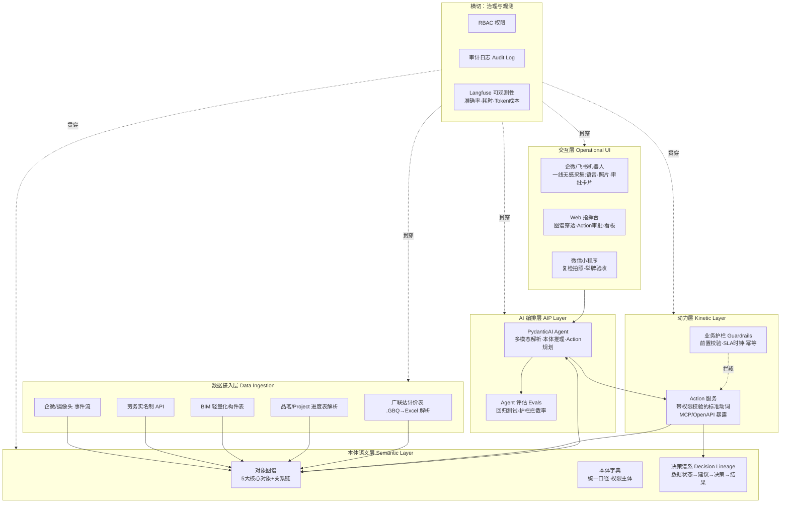
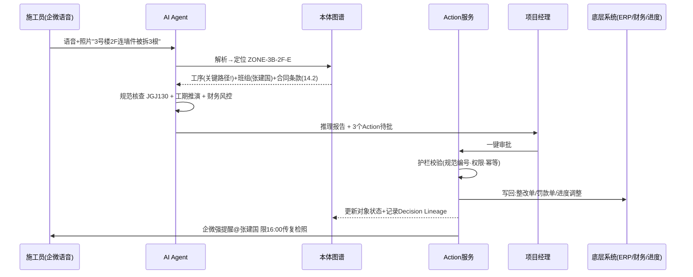
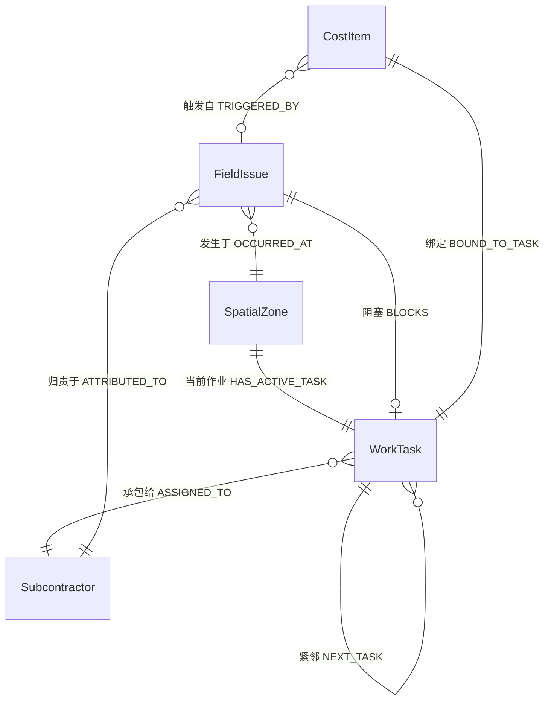
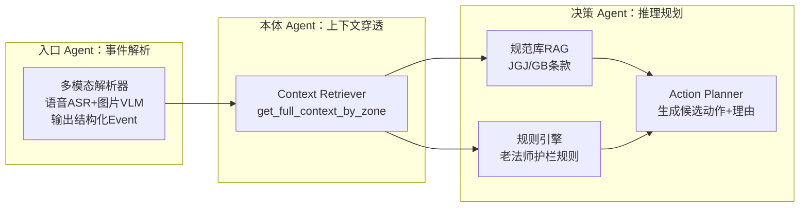
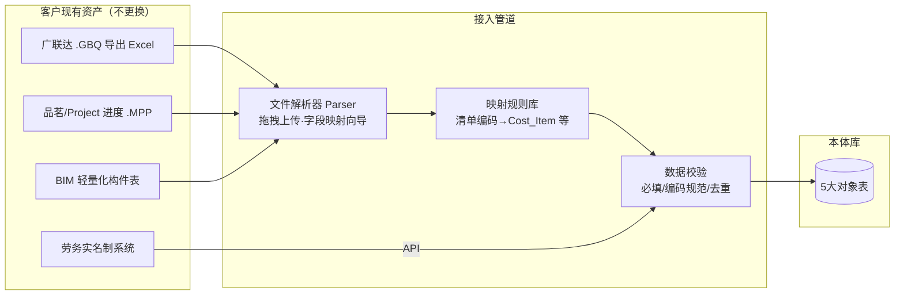
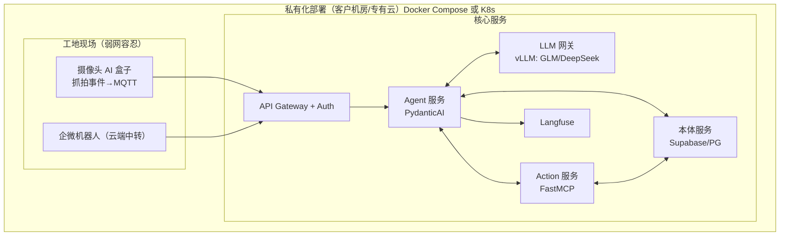

# 城建 AI 本体决策引擎 · 架构设计文档

> 版本 v1.0 | 2026-10-26 | 起源：[[企业技术建设/本体论/1029讨论]] | 演示原型：[[企业技术建设/本体论/ontology_demo.html|ontology_demo.html]]

---

## 1. 背景与定位

### 1.1 问题

城建行业的现有软件（广联达、品茗）是**割裂的工具与看板**：算量归算量、安全归安全、进度归进度，数据止步于大屏上的死图表。现场"非预期变动"（隐患整改、设计变更、现场签证）引发的**跨模块连锁决策**（谁整改、扣谁的钱、影响哪道工序、怎么调进度），全部依赖微信群吼 + 老法师脑子。

### 1.2 产品定位

**"AI 工程指挥官"** —— 不做第二个广联达，做挂在广联达/品茗/微信之上的**本体驱动决策大脑**：

- **寄生不替代**：解析对手系统导出的数据（Excel/进度表/BIM 构件表），做连接器而非替代者
- **名词互通**：用本体论把【空间部位 + 施工工序 + 劳务分包 + 成本签证】强行挂钩
- **动词闭环**：AI 不止报警，能自动发起整改、核算签证、拦截付款，人一键审批后**写回**底层系统
- **决策飞轮**：沉淀"数据状态 → AI 建议 → 人工决策 → 财务结果"全链路数据，构成竞争对手挖不走的核心资产

### 1.3 第一期业务目标（最小可行闭环）

跑通一个真实工地的两个场景：

| 场景 | 闭环内容 | 切谁的腹地 |
|---|---|---|
| A. 高危隐患停工整改 | 语音/照片 → 定位部位 → 定责班组 → 停工整改单 → 罚款冻结进度款 → 后续工序调配 | 品茗 |
| B. 现场签证防虚报 | 变更描述 → BIM 面积比对核减 → 自动套价 → 签证单草稿 → 证据链采集任务 → 审批 | 广联达 |

---

## 2. 总体架构

### 2.1 架构总览



**核心思想**：AI 永远不直接碰数据库表，只在**本体语义层**读上下文，通过**动力层受控动词**写回。这是整套架构的安全边界，也是与"裸大模型 + 提示词"方案的本质区别。

### 2.2 数据流（以场景 A 为例）



---

## 3. 本体语义层设计

### 3.1 五大核心对象（Semantic Layer）



#### 对象 1：空间部位 Spatial_Zone（锚点对象）

| 属性 | 类型 | 说明 |
|---|---|---|
| zone_id | text PK | 命名规范 `ZONE-{栋}-{层}-{方位}`，如 ZONE-3B-2F-E |
| 标段/楼栋/楼层/轴网位置 | text | 结构化位置树 |
| bim_net_area | numeric | **BIM 净面积/净量（防虚报基准）** |
| 高危等级 | enum | 临边/高空/深基坑/有限空间… |
| bim_component_ids | jsonb | 关联 BIM 轻量化构件 ID |

#### 对象 2：施工工序 Work_Task（动力主轴）

| 属性 | 类型 | 说明 |
|---|---|---|
| task_id | text PK | 如 TASK-102 |
| 计划开完工 / 实际进度% | date/numeric | 从品茗/Project 进度表同步 |
| is_critical_path | bool | **关键路径标记，决定 Action 2 是否升级** |
| next_task_id | text FK | 关键路径连锁推演的依据 |
| status | enum | 未开始/施工中/停工待复检/完工 |

#### 对象 3：分包班组 Subcontractor（责任主体）

| 属性 | 类型 | 说明 |
|---|---|---|
| sub_id | text PK | 如 SUB-08 |
| 班组长/联系方式/企微ID | text | 触达通道 |
| 历史违约·安全扣分 | numeric | 定责与罚款的信用依据 |
| unpaid_balance | numeric | 待付进度款余额 → 拦截对象 |
| penalty_clause | jsonb | 合同违约条款（编号/金额/条件） |

#### 对象 4：现场异常单 Field_Issue（事件对象）

| 属性 | 类型 | 说明 |
|---|---|---|
| issue_id | text PK | 如 FI-2026-042 |
| type | enum | 安全隐患/质量缺陷/设计变更/现场签证 |
| 严重等级 | enum | 一般/较大/重大（决定是否停工） |
| 证据附件 | jsonb | 现场照片(含水印)/语音转写/抓拍帧 |
| 整改截止时间 + 状态时钟 | timestamptz | **逾期自动升级触发 Action 2** |
| state | enum | 待整改/整改中/待复检/已闭环 |

#### 对象 5：成本清单与签证 Cost_Item（钱的对象）

| 属性 | 类型 | 说明 |
|---|---|---|
| item_code | text | 广联达清单编码，如 011001001002 |
| 合同综合单价 / 计量单位 | numeric/text | 已锁价，套价依据 |
| 预算量 / 已完量 / 变更增减 | numeric | 动态成本台账 |
| 规范/合同依据条款 | text | 签证单上的"铁证"字段 |

### 3.2 本体字典

单独的 `glossary` 表：术语、定义、口径归属（销售口径 vs 财务口径强制唯一）。所有 AI 提示词中的业务名词必须引用字典条目 ID，防止口径漂移。第一期只需 30~50 条核心术语（有效隐患、关键路径、已完工程量、签证…）。

### 3.3 存储实现（演进式）

| 阶段 | 存储 | 理由 |
|---|---|---|
| Phase 1 | **Supabase (PostgreSQL)**，对象=表、关系=FK，jsonb 存动态属性 | 5 个对象用图库是杀鸡用牛刀；RLS 行级权限白送 |
| Phase 2 | 关系查询性能不够时，加 **视图 + 物化路径**（`zone_task_sub_cost` 穿透视图） | 穿透查询是最高频操作，一张视图直达 |
| Phase 3 | 多项目/跨项目分析时再引入 **Neo4j**（只读副本，从 PG 同步） | 图算法（延误传播分析）才有价值 |

---

## 4. 动力层设计

### 4.1 Action 契约（所有动词的统一规范）

每个 Action = 一个带护栏的标准函数，通过 **MCP (Model Context Protocol)** 暴露给 Agent：

```python
# Action 契约伪代码（Pydantic 强类型）
class ActionRequest(BaseModel):
    action_type: Literal["issue_safety_penalty", "create_cost_visa", "reschedule_downstream", "freeze_payment"]
    actor_id: str          # 谁批准的（human-in-the-loop 凭据）
    context_refs: dict     # 引用的本体对象 ID（zone_id, sub_id, issue_id...）
    payload: dict          # 参数（金额、面积、时限...）
    idempotency_key: str   # 防重复执行

class GuardrailResult(BaseModel):
    passed: bool
    violations: list[str]  # 未过护栏的具体原因，回给 AI 和人看
```

**护栏前置校验清单（每个 Action 必须全过才执行）：**

1. **权限**：actor 是否有该 Action × 该对象的授权（见 §6 权限矩阵）
2. **证据链**：如安全罚款必须引用 JGJ/GB 规范编号；>3 万签证必须挂监理签字+水印照
3. **业务规则**：报价/签证金额上限、损耗率上限（如 BIM 面积 ×1.03）等"老法师规则"
4. **幂等**：同一 idempotency_key 只执行一次
5. **状态机**：对象当前状态允许该动作（已闭环的隐患单不能再开罚单）

### 4.2 四大核心 Action 规格

| # | Action | 触发 | 本体穿透路径 | 写回目标 | 审批模式 |
|---|---|---|---|---|---|
| 1 | AI 多模态巡检立项定责 | 企微语音/照片/摄像头抓拍 | 语音→部位→工序→班组→规范库 | 生成 Field_Issue + 企微强提醒 | 自动执行（事后可申诉） |
| 2 | 停工/延误连锁推演与重排 | 高危单逾期 / 停工令 / 变更单 | 部位→工序→关键路径→next_task 连锁计算 | 生成《进度调整建议》+ 通知下游班组 | 项目经理一键确认 |
| 3 | 签证/罚款自动算量计价 | 变更单/签证申报/违约事件 | 部位→BIM净量→核减→清单单价→合同条款 | 生成签证单/扣款单草稿→审批 | 预算总监一键审批 |
| 4 | 分包结算款安全拦截 | 月度/节点付款申请 | 班组→名下未闭环 Field_Issue→完工%比对 | 冻结付款审批流 | 财务+项目经理双确认 |

### 4.3 Action 写回通道

- **企微/飞书**：强提醒卡片、审批流 API（复用现有 IM，一线零学习成本）
- **自有台账**：直接写 PG（动态成本表、违约扣分表）
- **外部系统**（ERP/财务/进度）：第一期只做**单向草稿推送**（生成标准单据文档+推送提醒），不直连写；第二期按客户接口情况接 Webhook

---

## 5. AI 编排层设计

### 5.1 Agent 拓扑（PydanticAI）



- **模型选型**：国内私有化交付优先 GLM / DeepSeek（私有化部署成熟）；多模态解析（照片识别隐患）可用 Qwen-VL。模型全部走可替换的 LLM 网关层——**换模型不换本体**，这是架构的铁律
- **规范库 RAG**：JGJ/GB 规范 PDF 切片 + 条款级检索，Action 1 的"规范核查"依据必须来自这里，禁止模型凭记忆编条款
- **Evals**：每个场景维护 20~50 条回归用例（语音文本→期望的定责对象/金额区间），每次换模型/改提示词跑一遍，准确率<90% 不发布

### 5.2 人机协同（Human-in-the-loop）

- 除 Action 1 的自动立项外，所有写回动作默认**人批后执行**
- 审批界面展示：AI 推理报告（依据什么对象/规范/条款）+ 差异高亮（如"申报 450㎡ → 核准 445㎡，核减 5㎡"）
- 驳回时强制选择原因标签 → 这是反哺 Evals 和规则的黄金数据

### 5.3 决策谱系表（决策飞轮的物理载体）

```sql
CREATE TABLE decision_events (
    id uuid PRIMARY KEY DEFAULT gen_random_uuid(),
    ts timestamptz DEFAULT now(),
    scenario_type text,              -- safety_penalty / cost_visa / ...
    context_snapshot jsonb,          -- 当时本体上下文快照（5对象状态）
    ai_proposal jsonb,               -- AI建议的Action+理由+置信度
    human_decision text,             -- approved / rejected / modified
    reject_reason_tags text[],       -- 驳回原因标签
    actions_executed jsonb,          -- 实际执行了哪些
    financial_outcome numeric,       -- 关联的罚款/核减金额（闭环后回填）
);
```

一年后这张表就是全行业独一无二的"工程决策链路数据"。

---

## 6. 权限与安全设计

### 6.1 RBAC × Action 授权矩阵

| 角色 | 定位对象 | Action1 立项 | Action2 重排 | Action3 签证 | Action4 拦截 |
|---|---|---|---|---|---|
| 安全员/施工员 | 本标段 | ✓(只读引用) | — | — | — |
| 班组长 | 本班组 | — | — | 申报(非执行) | — |
| 项目经理 | 本项目 | ✓ | ✓ | 转批 | ✓(会签) |
| 预算总监 | 本项目 | 只读 | 只读 | ✓ | 只读 |
| 财务 | 本项目 | 只读 | 只读 | 只读 | ✓(会签) |

- 用 Supabase **RLS** 实现行级隔离（班组只见自己的单），动作级授权在 Action 服务集中校验
- AI Agent 的身份 = 发起用户的身份 + "agent" 声明，**绝不拥有超越其用户的权限**（AI 不能碰财务底表）

### 6.2 其他安全约束

- 一线语音/照片先脱敏（人脸/无关人员模糊化）再入 LLM
- 所有 LLM 调用走自建网关，敏感数据不出私有化边界
- 审计日志 append-only，独立存储，任何人（含管理员）不可篡改

---

## 7. 技术选型汇总（2026 开源栈）

| 层 | Phase 1（现在） | Phase 2（3~6月） | Phase 3（6月+） |
|---|---|---|---|
| 对象存储 | Supabase (PG + RLS + Auth) | + 穿透物化视图 | + Neo4j 只读副本（图分析） |
| 本体定义 | Pydantic 模型即本体（代码优先） | Ontop 虚拟图谱对接存量库 | SHACL 规则校验（多客户时） |
| Action 协议 | MCP Server（Python，FastMCP） | OpenAPI 文档化，客户系统对接 | 插件市场（客户自定义 Action） |
| Agent 框架 | **PydanticAI**（强类型天然对齐本体） | LangGraph（多 Agent 状态机） | — |
| LLM | GLM/DeepSeek 私有化 + 网关 | Qwen-VL 多模态 | 模型路由（成本优化） |
| 知识检索 | pgvector（规范条款 RAG） | GraphRAG（跨对象关系问答） | — |
| 交互 | 企微机器人 + 审批卡片 | Web 指挥台（React + AntV G6 图谱） | 小程序（复检拍照/举牌验收） |
| 编排自动化 | — | n8n（定时扫描逾期单→触发 Action2） | — |
| 可观测/评估 | **Langfuse** 自部署 | Evals 流水线接入 CI | 决策飞轮看板 |

> 明确不用的：OWL/Protégé/Jena 等学术级本体工具（当前阶段是负担）；Dify/Coze 可视化编排（第一期动作少，代码即文档更可控，Phase 2 可给客户开放低配置编排）。

---

## 8. 数据接入层设计（寄生策略）



- **一键导入**是第一期对客户的最大卖点：现场演示"拖一张广联达清单进来，5 分钟生成挂好关系的本体"
- 字段映射规则按客户沉淀成模板，第二个同类项目零配置导入
- 增量同步：文件类按周/事件触发重导（带版本号）；API 类实时

---

## 9. 部署架构



- 单项目最小规格：1 台 16C/64G/双卡 GPU 服务器（跑 14B 级模型 + 全套服务），预算 ~15 万
- 多项目：核心服务集中 + 工地只留边缘盒子

---

## 10. 实施路线图

| 阶段 | 周期 | 交付物 | 验收标准 |
|---|---|---|---|
| **Phase 0 骨架** | 第 1-2 周 | PG 建表（5 对象+decision_events）、PydanticAI 跑通 2 个 Action、Langfuse 上线 | Demo 2 代码长在真实栈上，`python` 调通全链路 |
| **Phase 1 试点** | 第 3-8 周 | 文件导入管道、企微机器人（语音→立项→审批卡片）、WebMVP 指挥台 | 1 个真实工地跑场景 A+B 两周，一线每周真实使用≥20 次 |
| **Phase 2 沉淀** | 第 9-16 周 | Evals 流水线、n8n 定时扫描、图谱可视化、决策飞轮看板 | 定责准确率≥90%；签证核减挽回金额可量化（对客报价的锚点） |
| **Phase 3 复制** | 第 17 周+ | 部署模板化、字段映射模板库、多租户 | 第二个项目交付周期 ≤ Phase 1 的一半 |

## 11. 关键风险与对策

| 风险 | 对策 |
|---|---|
| 一线不用（最大风险） | 只寄生企微，零新软件学习；语音/拍照即全部操作 |
| AI 定责错误引发纠纷 | Action 1 自动立项但留申诉通道；每次定责附证据链与规范条款；驳回标签反哺 Evals |
| 客户数据不愿出内网 | 全栈私有化，LLM 本地 vLLM 部署 |
| 对手接口封闭 | 全走"导出文件解析"路线，不依赖对方开放 API |
| 规范条款引用幻觉 | 强制 RAG 命中才允许开罚单（护栏第 2 条），未命中转人工 |

---

## 附：与 1029 讨论稿的对应关系

- 五对象、四 Action、寄生策略 → 源自 [[企业技术建设/本体论/1029讨论]] 第二部分 MVO
- 开源选型（PydanticAI/Supabase/Langfuse/G6）→ 源自选型结论讨论
- 本文档新增：Action 契约与护栏清单、决策谱系表结构、RBAC 矩阵、部署架构、实施路线图、风险对策
